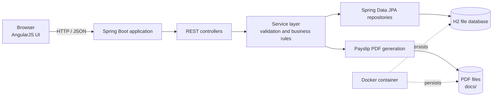

# ACME Salary Management

ACME Salary Management is a Spring Boot web application for managing employee
records, salary history, leave balances and leave records, payments, and
downloadable payslips. It includes an AngularJS interface and a REST API.

## Features

- Employee directory with search, filters, sorting, pagination, and Excel import.
- Salary history management with effective-date overlap validation.
- Leave balance management, leave recording, and leave history.
- Payment recording with salary snapshots and unpaid-leave deductions.
- Payslip generation and PDF downloads.
- Session login/logout and persisted H2 storage.

## Technology

- Java 21 and Spring Boot
- Spring MVC, Spring Data JPA, and Bean Validation
- H2 database
- AngularJS and UI-Router
- Maven

## Planning and design notes

- Employee records are the root of the domain. Salary rows hold effective-date
  ranges; payments keep a snapshot of salary amounts so later salary edits do
  not change past payment records.
- Leave balances and dated leave records are separate. Payment recording uses
  unpaid leave within the pay period to calculate deductions.
- Payslip PDFs are generated from recorded payments and stored separately from
  the database.
- The frontend is served by Spring Boot and calls the same application's `/api`
  endpoints. Controllers handle HTTP concerns, services contain business rules,
  repositories handle persistence, and DTOs define API payloads.
- Employee and payment listings are paginated. Employee pages are capped at
  100 records; payment pages are capped at 100 records.

## Architecture



## Trade-offs

- **H2 file database:** keeps local setup and single-container deployment simple.
  For production workloads requiring multiple application instances or stronger
  database operations, use a managed database such as PostgreSQL and plan a
  migration.
- **Filesystem payslips:** PDFs are straightforward to generate and serve from
  local storage. Multiple application instances need shared durable storage or
  an object store so every instance can access the same payslips.
- **Server-rendered static hosting with AngularJS:** avoids a separate frontend
  build and server, but keeps the client on AngularJS rather than a current
  frontend framework.
- **Manual seed scripts:** sample data is opt-in to avoid modifying a real
  database at startup. The delete script is scoped by a seed-specific email
  marker, but should not be used after dependent payment data is added.

## Performance considerations

- Employee and payment queries use server-side pagination, with a maximum page
  size of 100 to limit response sizes. Choose the smallest page size that works
  for the screen or client.
- Employee filtering and sorting should use indexed database columns if dataset
  size or query latency grows; verify query plans before adding indexes.
- The 10,000-employee seed is useful for exercising list screens and pagination.
  Bulk imports and seeds should be run deliberately and monitored for database
  write time and disk usage.
- Payslip generation performs PDF work and filesystem I/O. For large batches,
  monitor CPU, memory, and disk capacity; retain the mounted `salary-docs`
  volume when replacing containers.
- A single H2 file and local PDF directory are intended for simple deployments.
  They can become bottlenecks or coordination constraints under concurrent
  multi-instance traffic; move persistence to shared production-grade services
  as scaling requirements grow.

## Run locally

Install Java 21 or newer. From the repository root, start the application with
the Maven wrapper:

```powershell
.\mvnw.cmd spring-boot:run
```

On macOS/Linux:

```sh
./mvnw spring-boot:run
```

The app is available at <http://localhost:8080>. The default HR username is
`hr.manager`; set a private password with `HR_PASSWORD` before exposing the app:

```powershell
$env:HR_PASSWORD = "replace-with-a-strong-password"
.\mvnw.cmd spring-boot:run
```

The default H2 database is stored in `data/salarydb`. Generated payslips are
stored under `docs/`. Both paths are ignored by Git.

## Run with Docker

Build the image:

```sh
docker build -t salary-management:local .
```

Run the app with persistent volumes for the database and payslips:

```sh
docker run --name salary-management -p 8080:8080 \
  -e HR_USERNAME=hr.manager \
  -e HR_PASSWORD=replace-with-a-strong-password \
  -v salary-data:/app/data \
  -v salary-docs:/app/docs \
  salary-management:local
```

Open <http://localhost:8080>. Keep the named volumes when replacing the
container to preserve stored data. Rebuilding an image does not update an
already-running container; recreate it to use the new image.

## Seed sample data

Optional H2 scripts create 10,000 employees (`P00001`–`P10000`) with one salary
each. They are not run automatically. The scripts use a unique email marker to
identify seeded records; the delete script removes only matching employees and
their salary rows.

With the Docker container running, seed the database:

```sh
docker exec salary-management java -cp /app/h2.jar org.h2.tools.RunScript \
  -url 'jdbc:h2:file:/app/data/salarydb;AUTO_SERVER=TRUE' \
  -user sa \
  -script /app/scripts/seed-10000-employees.sql
```

Delete the sample employees and salaries:

```sh
docker exec salary-management java -cp /app/h2.jar org.h2.tools.RunScript \
  -url 'jdbc:h2:file:/app/data/salarydb;AUTO_SERVER=TRUE' \
  -user sa \
  -script /app/scripts/delete-10000-employees.sql
```

Do not delete the sample employees if they have payments or other dependent
records. For non-Docker setup and additional details, see
[scripts/README.md](./scripts/README.md).

## Tests and build

Run the test suite:

```powershell
.\mvnw.cmd test
```

On macOS/Linux:

```sh
./mvnw test
```

Package the application:

```powershell
.\mvnw.cmd package
```

## API documentation

When the app is running, Springdoc serves Swagger UI at
<http://localhost:8080/swagger-ui/index.html> and the OpenAPI document at
<http://localhost:8080/v3/api-docs>.

## Project layout

```text
src/main/java/                  Spring Boot application and REST API
src/main/resources/static/      AngularJS frontend
src/test/java/                  Automated tests
scripts/                        Optional H2 seed and cleanup SQL scripts
Dockerfile                      Multi-stage Docker image
```
